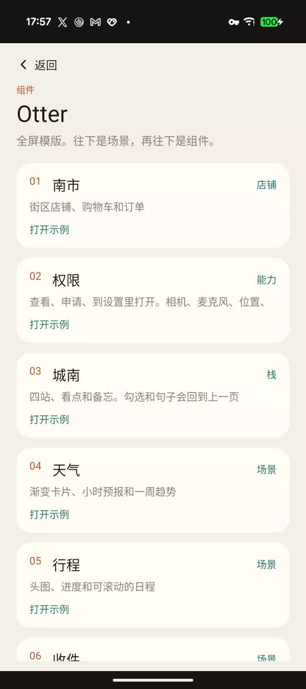
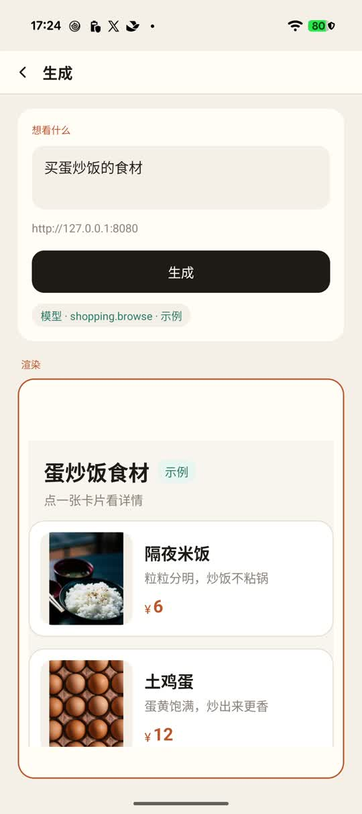

# Otter

Otter 是一套生成式 UI。模型或服务只产出一份受约束的 JSON 模版，Android、iOS、Web 用各自的原生界面画出来。页面结构和数据分开：结构是 JSON 模版，数据是另一份 JSON。

布局使用来自 [GaiaX](https://github.com/alibaba/GaiaX) 的 Flexbox 引擎，`$` 表达式使用来自 GaiaX 的表达式引擎。出处和许可证见 [来源声明](otter-android/README.md#来源声明)。

[五个端](#五个端) · [Demo](#demo-示例) · [文档](#文档) · [节点](#节点) · [跑起来](#跑起来)

## 介绍

<table>
<tr>
<td align="center" width="50%">

</td>
<td align="center" width="50%">

</td>
</tr>
<tr>
<td align="center"><a href="otter-android/docs/media/intro.mp4">走查</a> · 16 秒 首页、天气卡、城南，再点进「旧巷咖啡」。<a href="otter-android/docs/demo-guide.md">说明</a></td>
<td align="center"><a href="otter-android/docs/media/generate.mp4">生成</a> · 20 秒 查询「买蛋炒饭的食材」，点进「隔夜米饭」。<a href="otter-android/docs/demo-guide.md#查询下发">查询下发</a> · <a href="otter-web/docs/demo-guide.md">Web</a></td>
</tr>
</table>

## 五个端

| 目录 | 内容 | 进入 |
| --- | --- | --- |
| `otter-android` | Android SDK 和 Demo。模版协议也写在这里 | [README](otter-android/README.md) |
| `otter-ios` | iOS SDK 和 Demo。示例在 `otter-ios/Demo` | [README](otter-ios/README.md) |
| `otter-web` | Web SDK 和 Demo。示例在 `otter-web/templates` | [README](otter-web/README.md) |
| `otter-harbor` | Go 服务。query 进来，签名 zip 出去 | [README](otter-harbor/README.md) |
| `otter-studio` | 模版管理后台。列出签名包，用 query 生成，再下载 | [README](otter-studio/README.md) |

## Demo 示例

和 Android Demo 导航页一致。点「模版」或「数据」打开 JSON。Web 的同一批在 [otter-web/templates](otter-web/templates)，iOS 在 [otter-ios/Demo](otter-ios/Demo)。

### 场景

| 页面 | 看到什么 | 打开 |
| --- | --- | --- |
| 南市 | 店铺、购物车和订单 | [路由](otter-android/Demo/src/main/assets/templates/market/routes.json) · [首页](otter-android/Demo/src/main/assets/templates/market/mock-data/home.json) · [店铺](otter-android/Demo/src/main/assets/templates/market/shop.json) · [购物车](otter-android/Demo/src/main/assets/templates/market/mock-data/cart.json) |
| 权限 | 相机、麦克风、位置、相册、通知 | [路由](otter-android/Demo/src/main/assets/templates/permission/routes.json) · [数据](otter-android/Demo/src/main/assets/templates/permission/mock-data/permission.json) |
| 城南 | 四站、看点和备忘 | [路由](otter-android/Demo/src/main/assets/templates/stack/routes.json) · [货架](otter-android/Demo/src/main/assets/templates/stack/mock-data/shelf.json) · [咖啡](otter-android/Demo/src/main/assets/templates/stack/mock-data/coffee.json) |
| 天气 | 渐变卡片和一周趋势 | [模版](otter-android/Demo/src/main/assets/templates/weather-card-demo/weather-card.json) · [数据](otter-android/Demo/src/main/assets/templates/weather-card-demo/mock-data/weather-card.json) |
| 行程 | 头图、进度和日程 | [模版](otter-android/Demo/src/main/assets/templates/journey/journey.json) · [数据](otter-android/Demo/src/main/assets/templates/journey/mock-data/journey.json) |
| 收件 | 一长串会话 | [模版](otter-android/Demo/src/main/assets/templates/inbox/inbox.json) · [数据](otter-android/Demo/src/main/assets/templates/inbox/mock-data/inbox.json) |
| 播放 | 封面、进度和控制 | [模版](otter-android/Demo/src/main/assets/templates/player/player.json) · [数据](otter-android/Demo/src/main/assets/templates/player/mock-data/player.json) |
| 聊天 | 气泡和底部输入 | [模版](otter-android/Demo/src/main/assets/templates/chat/chat.json) · [数据](otter-android/Demo/src/main/assets/templates/chat/mock-data/chat.json) |
| 液态玻璃 | 磨砂、染色、按住变亮 | [模版](otter-android/Demo/src/main/assets/templates/glass/glass.json) · [数据](otter-android/Demo/src/main/assets/templates/glass/mock-data/glass.json) |

南市另外两条路由是 [订单](otter-android/Demo/src/main/assets/templates/market/routes-orders.json) 和 [我的](otter-android/Demo/src/main/assets/templates/market/routes-mine.json)。城南四站共用 [place.json](otter-android/Demo/src/main/assets/templates/stack/place.json)，数据是 [咖啡](otter-android/Demo/src/main/assets/templates/stack/mock-data/coffee.json)、[书](otter-android/Demo/src/main/assets/templates/stack/mock-data/book.json)、[市集](otter-android/Demo/src/main/assets/templates/stack/mock-data/market.json)、[灯](otter-android/Demo/src/main/assets/templates/stack/mock-data/lamp.json)。流程见 [几条长一点的流程](otter-android/docs/demo-guide.md#几条长一点的流程)。

### 组件

| 页面 | 看到什么 | 打开 |
| --- | --- | --- |
| Column | 纵向容器 | [模版](otter-android/Demo/src/main/assets/templates/column/column.json) · [数据](otter-android/Demo/src/main/assets/templates/column/mock-data/column.json) |
| Row | 横向容器 | [模版](otter-android/Demo/src/main/assets/templates/row/row.json) · [数据](otter-android/Demo/src/main/assets/templates/row/mock-data/row.json) |
| Text | 文案、颜色、字号和对齐 | [模版](otter-android/Demo/src/main/assets/templates/text/text.json) · [数据](otter-android/Demo/src/main/assets/templates/text/mock-data/text.json) |
| Image | 本地图和网络图 | [模版](otter-android/Demo/src/main/assets/templates/image/image.json) · [数据](otter-android/Demo/src/main/assets/templates/image/mock-data/image.json) |
| Spacer | 留白、分割线和圆角 | [模版](otter-android/Demo/src/main/assets/templates/spacer/spacer.json) · [数据](otter-android/Demo/src/main/assets/templates/spacer/mock-data/spacer.json) |
| List | 纵向和横向列表 | [模版](otter-android/Demo/src/main/assets/templates/list/list.json) · [数据](otter-android/Demo/src/main/assets/templates/list/mock-data/list.json) |
| Progress | 区间、颜色和动画 | [模版](otter-android/Demo/src/main/assets/templates/progress/progress.json) · [数据](otter-android/Demo/src/main/assets/templates/progress/mock-data/progress.json) |
| Lottie | 资源、重复和播放 | [模版](otter-android/Demo/src/main/assets/templates/lottie/lottie.json) · [数据](otter-android/Demo/src/main/assets/templates/lottie/mock-data/lottie.json) |
| Input | 文案、占位、键盘和字数 | [模版](otter-android/Demo/src/main/assets/templates/input/input.json) · [数据](otter-android/Demo/src/main/assets/templates/input/mock-data/input.json) |
| CheckBox | 选中、全选和全不选 | [模版](otter-android/Demo/src/main/assets/templates/checkbox/checkbox.json) · [数据](otter-android/Demo/src/main/assets/templates/checkbox/mock-data/checkbox.json) |
| Radio | 同组互斥 | [模版](otter-android/Demo/src/main/assets/templates/radio/radio.json) · [数据](otter-android/Demo/src/main/assets/templates/radio/mock-data/radio.json) |
| Switch | 开关和颜色 | [模版](otter-android/Demo/src/main/assets/templates/switch/switch.json) · [数据](otter-android/Demo/src/main/assets/templates/switch/mock-data/switch.json) |

真机上怎么打开这些页，写在 [Demo 指南 · 入口](otter-android/docs/demo-guide.md#入口)。

## 文档

协议字段只维护一份，在 `otter-android/docs`。

| 分组 | 文档 |
| --- | --- |
| 协议 | [架构](docs/architecture.md) · [协议索引](docs/protocol.md) · [模版格式](otter-android/docs/template-format.md) · [节点字段](otter-android/docs/node-types.md) |
| Android | [渲染](otter-android/docs/render-pipeline.md) · [接入](otter-android/docs/sdk-integration.md) · [Demo](otter-android/docs/demo-guide.md) · [SDK](otter-android/README.md) |
| Web | [渲染](otter-web/docs/render-pipeline.md) · [接入](otter-web/docs/sdk-integration.md) · [Demo](otter-web/docs/demo-guide.md) |
| 其它 | [iOS](otter-ios/README.md) · [Harbor](otter-harbor/README.md) · [Studio](otter-studio/README.md) · [OpenSpec](openspec) |

## 动态化在说什么

原生页面通常把界面写进安装包。改一个卡片的结构，就要发一版应用。

动态化把「界面长什么样」从安装包里拿出来，换成运行时才读到的一份描述。客户端里固定的是渲染器、组件种类和允许的交互。描述换了，页面就换了，应用本身不用重新发版。

| 层次 | 运行时拿到的是什么 | 客户端负责什么 |
| --- | --- | --- |
| 热更新 | 一份可执行代码或脚本包 | 把包跑起来。能力大，也更难审计 |
| 配置化 / Server-Driven UI | 一份组件树描述，组件种类是客户端已经实现的 | 按协议画出原生界面，数据再填进去 |
| 生成式 UI | 同一份协议，由模型按当轮上下文现写 | 校验这份输出，合法才渲染 |

热更新适合整页业务逻辑一起换。生成式 UI 适合「这一次该给用户看什么」：天气、行程、消息、播放器，每次的结构和文案都不一样，模型不直接执行代码。

所以生成式 UI 需要一份窄协议。模型只能使用约定好的节点和动作。多出来的字段、不认识的 `type`、指向不存在节点的点击，会在上屏之前被解析器拒绝。生成时要遵守的输出约定写在 [模版格式](otter-android/docs/template-format.md)：只输出一份 JSON，结构归模版，数据归另一份 JSON。

## 这套协议后面用来做什么

Otter 做生成式 UI 的这一端：协议、校验、布局、渲染、有限的交互。模型、提示词和模版下发可以换，渲染协议保持这一套。Android 用原生 `View`，iOS 用原生视图，Web 用 DOM。差别见 [架构 · 各端画出来的方式](docs/architecture.md#各端画出来的方式)。

一次完整链路是：

1. 用户的问题、车辆或业务上下文进模型。Harbor 的入口是 `POST /api/v1/generate`，见 [架构 · 一次生成](docs/architecture.md#一次生成)。
2. 模型按协议写出模版 JSON，需要展示的业务数据可以仍由客户端或服务提供。
3. 解析器校验。未知字段、未知 `type`、悬空的 `onClick` 或 `target` 直接拒绝。
4. 布局引擎按当前视口算出位置，各端创建自己的界面节点。
5. 用户点击只触发事件表里的动作。打开哪个页面由宿主决定，模型只写页面名。

模版和数据分开，是为了让模型负责结构，业务系统负责事实。例如模版写 `text: "$title"`，标题文本来自数据 JSON，模型不必把每条订单、每条消息都编进界面描述里。

交互收在白名单里：toast、改文案、改选中态、往列表追加、打开已注册的页面、返回。网络请求、页面栈和业务脚本留在宿主里，模版只引用这些已经约定的动作。

上面的天气卡、行程、收件箱、播放器、对话页和液态玻璃，就是这类界面的样子。它们现在读本地 JSON，是为了把协议跑通。接上模型之后，同一批组件用来承接模型刚生成的那一屏。

适合放进 Otter 的界面：

- 对话或助手里的结果卡片。答案不只是一段字，而是一张能点的原生卡片。
- 随上下文变化的轻页面。同一次会话里，天气、日程、播放器可以是不同模版。
- 需要一点输入的界面。勾选、单选、开关、输入框和列表追加都在协议内，结果仍留在客户端。
- 运营位和活动位。同一套渲染器，换 JSON 就换页面。
- 手机、车机、助手面板这类不同宿主。宿主只提供容器、数据和「打开某页」的实现。

复杂业务流程写在宿主里。Otter 负责这一屏的结构和协议内的操作。

## 和市面上的动态化方案

动态化没有统一形态。差别主要在描述语言有多宽，以及客户端里跑的是脚本还是原生组件。

| 方案 | 描述方式 | 客户端里有什么 | 更适合 |
| --- | --- | --- | --- |
| H5 / WebView | HTML、CSS、JS | 浏览器内核 | 活动页、长尾内容。表现力高，滚动、手势和视觉跟原生应用是两套 |
| React Native、Weex、Hippy | JavaScript 包 | JS 引擎加上一批原生组件 | 整页业务动态发版。能写逻辑，包体和运行时也更重 |
| Flutter | Dart 界面 | 自绘引擎 | 整应用跨端。动态下发能力弱，不适合当作模型的输出格式 |
| Lynx | 标记语言和样式 | 自研渲染运行时 | 信息流里的高性能卡片。前端能力完整，协议对模型来说偏宽 |
| Kuikly | Kotlin 界面 | 跨端运行时 | 工程师用 Kotlin 写跨端页面，并支持动态下发 |
| GaiaX、DinamicX | 模版加表达式 | 原生 `View`、布局和表达式引擎 | 电商卡片、运营位。和 Otter 同属原生模版引擎，组件和表达式更面向业务方手写 |
| DivKit | JSON | Android、iOS、Web 各自的渲染器 | 服务端驱动 UI。同样用 JSON 描述界面，跨端更全 |
| Otter | 收窄后的 JSON | Android / iOS 原生界面、Web DOM、Stretch、表达式引擎、事件白名单 | 模型按协议生成卡片和轻页面，客户端先校验再渲染 |

Otter 和 GaiaX、DinamicX、DivKit 同属一类：界面描述交给渲染器。Otter 把协议收得更窄，节点种类固定，事件种类固定，解析器拒绝协议外的字段。模型的输出空间就是这一份 schema，不合法的生成停在解析阶段。

H5、React Native、Lynx、Kuikly 更适合已经有前端或跨端团队、需要完整业务逻辑的页面。那些描述语言对模型过宽，生成结果也不容易在上屏前做穷尽校验。

## 节点

每个节点都要有 `type`、`layout.width`、`layout.height`。尺寸是 dp 数字，或 `"fill"` / `"wrap"`。字段表在 [节点字段](otter-android/docs/node-types.md)，示例 JSON 就是上面的组件页。

| type | 作用 | 示例 |
| --- | --- | --- |
| `column` / `row` | 纵向或横向容器，子节点放在 `children`。只有 `column` 可以写 `scroll`。`column`、`row`、`spacer` 可以写 `style.glass` | [column](otter-android/Demo/src/main/assets/templates/column/column.json) · [row](otter-android/Demo/src/main/assets/templates/row/row.json) |
| `text` | 文本，`text` 必填。还可以写 `maxLines`、`ellipsis`、`fontWeight` | [text](otter-android/Demo/src/main/assets/templates/text/text.json) |
| `image` | 图片。`src` 可以是 `http(s)` 地址、`res:drawable名`，或以 `$` 开头的表达式。还可以写 `fit`、`placeholder` | [image](otter-android/Demo/src/main/assets/templates/image/image.json) |
| `spacer` | 占位或分割线 | [spacer](otter-android/Demo/src/main/assets/templates/spacer/spacer.json) |
| `list` | 列表。`data` 是 `$` 表达式，求值结果为对象数组；单项模版写在 `item` | [list](otter-android/Demo/src/main/assets/templates/list/list.json) |
| `progress` | 进度条，`from` / `to` 为 0 到 1 | [progress](otter-android/Demo/src/main/assets/templates/progress/progress.json) |
| `lottie` | Lottie。网络地址用 `https://`，包内动画用 `assets:`，不要自己加 `.json` | [lottie](otter-android/Demo/src/main/assets/templates/lottie/lottie.json) |
| `input` | 输入框，可选 `value`、`hint`、`keyboard`、`maxLength`。`lines` 不写则单行 | [input](otter-android/Demo/src/main/assets/templates/input/input.json) |
| `checkbox` / `switch` | 勾选和开关，可选 `checked`、`label` | [checkbox](otter-android/Demo/src/main/assets/templates/checkbox/checkbox.json) · [switch](otter-android/Demo/src/main/assets/templates/switch/switch.json) |
| `radio` | 单选，必填 `group` | [radio](otter-android/Demo/src/main/assets/templates/radio/radio.json) |

`column` 和 `row` 可以写 `layout.justify`、`layout.align`、`layout.wrap`。任意节点都可以写 `layout.grow`、`layout.padding`、`layout.margin`、`minWidth`、`minHeight`、`maxWidth`、`maxHeight`、`aspectRatio`、`alignSelf`，以及 `style` 里的背景、圆角、边框。`column`、`row`、`spacer` 还可以写 `style.glass`，不要和 `background` 一起写。任何节点都可以写 `visible`（布尔或 `$` 表达式）和 `onChange`。`visible` 为 `false` 时不参与布局。

## 事件

根对象的 `events` 用名字登记动作，节点用 `"onClick": ["事件名"]` 或 `"onChange": ["事件名"]` 引用，按数组顺序执行。完整字段在 [模版格式](otter-android/docs/template-format.md)。Android 上的分发过程在 [一次渲染做了什么](otter-android/README.md#一次渲染做了什么)。

| action | 作用 |
| --- | --- |
| `toast` | 弹出 `message` |
| `setText` | 把 `target` 节点的文案改成 `value`。目标可以是 `text` 或 `input` |
| `setTextStyle` | 改 `target` 的 `fontSize`、`color`、`text`，至少写一项 |
| `setChecked` | 设置 `checkbox`、`radio` 或 `switch` 的选中状态。`target` 可以是一个 id，也可以是 id 数组 |
| `append` | 从输入框取值，追加到 `list` |
| `update` | 按 `index` 替换 `list` 里的一项。`index` 是非负整数或 `$` 表达式。`item` 是字符串字段 |
| `remove` | 按 `index` 删掉 `list` 里的一项 |
| `open` | 打开 `page`。可带 `params`。挂了页面栈就在当前容器压入下一页；否则把页面名交给宿主 |
| `back` | 栈里多于一页时弹出栈顶，并可把结果写回上一页。否则结束当前页 |
| `replace` | 字段和 `open` 一样，用 `page` 换掉当前页 |
| `popTo` | 回到名为 `page` 的那一页 |
| `host` | 把 `name` 交给宿主。权限、播放、支付都走这个名字 |

`message`、`value`、`text`、`page`、`index`、`name` 都可以写 `$` 表达式。比较和缺省沿用 `"$week != null ? $week : '暂无'"` 这种写法。

聊天页能看到输入和追加：[chat.json](otter-android/Demo/src/main/assets/templates/chat/chat.json)。城南能看到打开、返回和写回：[routes.json](otter-android/Demo/src/main/assets/templates/stack/routes.json)。

多页怎么挂在一个 Activity 里，写在 [页面栈](otter-android/README.md#页面栈)。权限的三个 host 写在 [权限](otter-android/README.md#权限)，示例是 [权限页](otter-android/Demo/src/main/assets/templates/permission/permission.json)。

## 跑起来

| 端 | 命令 | 接着看 |
| --- | --- | --- |
| Android | 用 Android Studio 打开 `otter-android`，运行 `:Demo` | [编译和运行](otter-android/README.md#编译和运行) · [接入](otter-android/README.md#接入) |
| Web | 在 `otter-web` 里 `npm install` 然后 `npm run dev`，打开 `http://127.0.0.1:5174` | [Web Demo](otter-web/docs/demo-guide.md) |
| iOS | 用 Xcode 打开 `otter-ios/OtterDemo.xcodeproj`。工程编译 `otter-android` 里的表达式 C++ | [iOS README](otter-ios/README.md) |
| 生成服务 | 在 `otter-harbor` 里 `go run ./cmd/ottersrv`，健康检查 `http://127.0.0.1:8080/api/v1/health` | [Harbor](otter-harbor/README.md) |
| 真机 | USB 连接后执行 `adb reverse tcp:8080 tcp:8080`，Demo 里打开「生成」 | [查询下发](otter-android/docs/demo-guide.md#查询下发) |

## 来源

Flexbox 布局引擎和表达式引擎来自阿里巴巴优酷技术团队的开源项目 [GaiaX](https://github.com/alibaba/GaiaX)，以 Apache License 2.0 发布。Stretch 本体为 MIT。模版协议、组件和页面渲染流程是 Otter 自己的。文件位置、重命名和 NOTICE 写在 [来源声明](otter-android/README.md#来源声明)。
