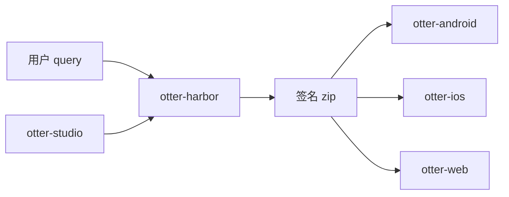

# 架构

Otter 把「这一屏长什么样」收成一份受约束的 JSON。五个端共用这一份协议：模型或离线逻辑写模版，客户端校验之后再画。



| 目录 | 负责 |
| --- | --- |
| `otter-android` | Android SDK、Demo，以及协议文档 |
| `otter-ios` | iOS SDK 和 Demo。示例模版在 `otter-ios/Demo` |
| `otter-web` | Web SDK 和 Demo。示例模版在 `otter-web/templates` |
| `otter-harbor` | 收 query，生成模版和示例数据，打成签名 zip |
| `otter-studio` | 管理后台。列出签名包，用 query 触发生成，再下载 |

模版描述结构，另一份 JSON 描述数据。十二种节点、`$` 表达式、事件和页面路由在各端含义相同。字段以 [template-format.md](../otter-android/docs/template-format.md) 和 [node-types.md](../otter-android/docs/node-types.md) 为准，索引见 [protocol.md](protocol.md)。

模型、提示词和网络请求不在客户端 SDK 里。宿主提供容器、数据，以及协议之外的业务动作。

## 一次生成

1. 宿主把 query 交给 `otter-harbor`：`POST /api/v1/generate`，再 `GET /api/v1/bundles/:id` 取 zip。
2. 服务识别意图，写出路由、两页模版和两份数据，计算摘要并做 ed25519 签名。
3. 客户端用调试公钥或生产公钥验签。摘要、签名、路径或模版不合法时拒绝安装。
4. 通过后，`PageStack` 按 `routes.json` 打开起始页。点击只执行事件表里的动作。

没配模型密钥时，服务按关键词离线写示例页。配了 `OTTER_LLM_API_KEY` 之后，购物意图由模型写模版。细节在 [otter-harbor/README.md](../otter-harbor/README.md)。

Studio 的开发服务器和 Web Demo 都把 `/api` 转到本机 `127.0.0.1:8080`。Harbor 的 CORS 只放行 Studio 的 `http://localhost:5173`，所以浏览器里的 Demo 不直连 8080。

## 签名包

包里恰好六个文件，都是 stored 方式的 zip 条目：

```
routes.json
templates/list.json
templates/detail.json
data/list.json
data/detail.json
manifest.json
```

单文件不超过 256KB，整包不超过 1MB。可执行权限和符号链接会被拒绝。

摘要是 SHA-256。五个内容文件按上面的顺序，每段是：文件名的 UTF-8、换行、十进制字节长度、换行、原始内容。`manifest.json` 的键只有 `id`、`intent`、`sample`、`createdAt`、`hash`、`alg`、`signature`。`alg` 必须是 `ed25519`。`signature` 是对原始 32 字节摘要的标准 base64，长度 64 字节。公钥 32 字节。

下载结果里的 `id`、`intent`、`sample` 要和 manifest 一致。安装失败时可以退回该槽上一份验过的包，也可以选择不退回。Android 调试公钥在 `otter-android/Demo/src/debug/res/raw/otter_dev_public.bin`，只和仓库里的调试私钥成对。

## 页面怎么留在客户端

单页由模版加数据画进宿主给的容器。多页由 `routes.json` 描述：`start` 和 `pages`。`open` 先读目标页的数据文件，再用事件里算出的 `params` 盖上去。栈最深 32 层。

`host` 事件只带一个名字和参数。支付、改数量、播放、权限这些动作由 Demo 或业务工程注册，模版里不写脚本。

播放进度和南市的购物车金额在 Demo 里维护，不在 SDK 里。SDK 负责把结果写回当前页数据并重新绑定。

## 各端画出来的方式

协议相同，绘制库按平台选：

| 端 | 布局 | 表达式 | 画面 |
| --- | --- | --- | --- |
| Android | GaiaX 的 Stretch | GaiaX 的 `OTAnalyze` | 原生 `View` |
| iOS | 同一套 Stretch | 编译 Android 工程里的表达式 C++ | 原生视图 |
| Web | `yoga-layout` | 按同一语法写的 TypeScript 解释器 | DOM |

Web 上 `env('isWeb')` 为真，`env('isAndroid')` 和 `env('isiOS')` 为假。液态玻璃用和 Android 同一套圆角折射：`regular` 中间有薄霜，`clear` 更透、边缘折得更明显。权限走浏览器自己的授权，不能代用户打开系统设置页。这些差别写在 [Web 渲染链路](../otter-web/docs/render-pipeline.md)。

布局和表达式的上游、许可证和仓库内位置见 [otter-android/README.md](../otter-android/README.md) 的来源声明。
