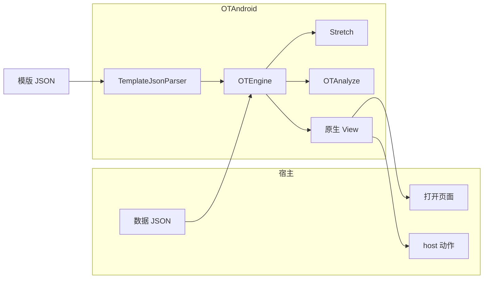
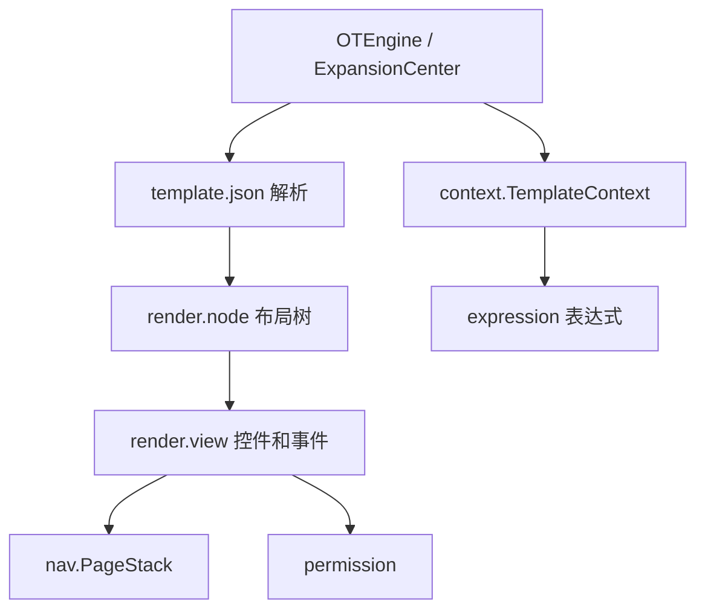
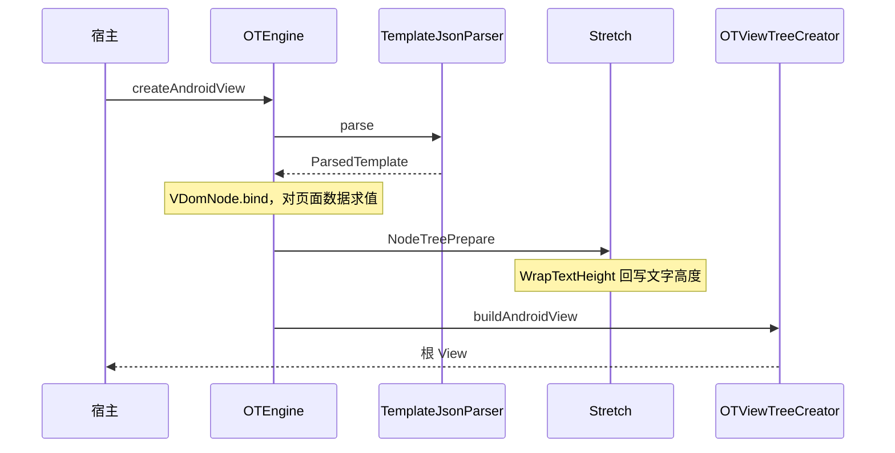
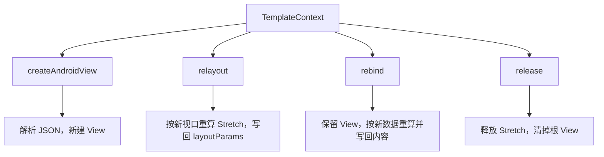
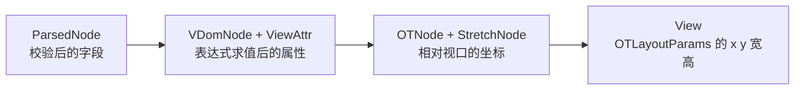
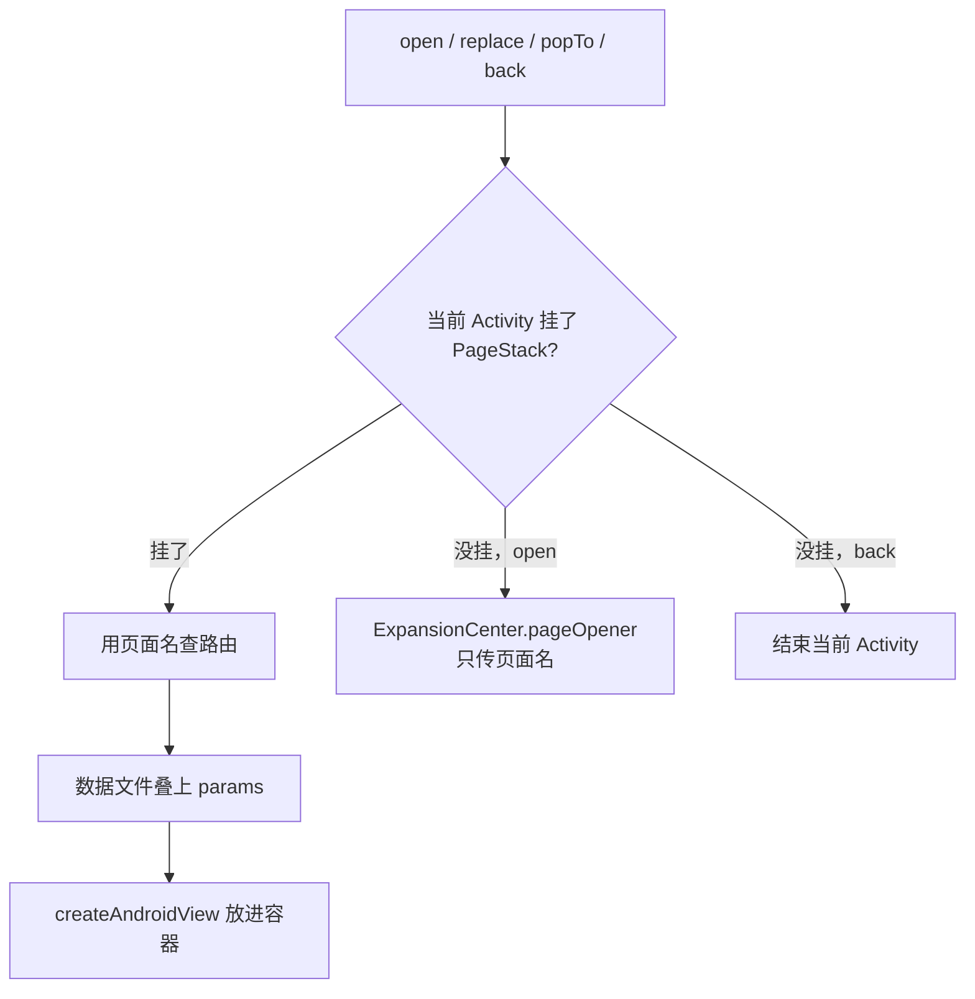

# 架构

`:OTAndroid` 读一份 JSON 模版，校验之后画成原生 `View`。`:Demo` 用 assets 里的模版把这条链路跑通，业务工程不用依赖它。

模版写结构，另一份 JSON 写数据。字段以 [template-json.md](template-json.md) 为准。这里写这些字段进客户端之后落在哪。

## 边界



模型、提示词、网络请求不在这个库里。宿主提供容器、数据和「打开某一页」的实现。模版里的点击只能走到事件表登记过的动作。

库的包名是 `com.dynamic.otter`，namespace 是 `com.dynamic.outter`。布局库 `libstretch.so` 只编了 `arm64-v8a`。

## 代码放在哪



| 包 | 干什么 |
| --- | --- |
| `OTEngine` | 读模版、创建 View、`relayout`、`rebind` |
| `ExpansionCenter` | 宿主注册打开页面、自定义 `host`、尺寸扩展 |
| `context` | 一份模版的数据、事件、根 View、视口 |
| `template.json` | 把 JSON 收成节点树和事件表，不合法就抛 `TemplateParseException` |
| `template` | 尺寸、颜色、Flex 样式 |
| `render.node` | `VDomNode`、`OTNode`、Stretch 绑定 |
| `render.view` | 创建控件、绑定内容、分发点击 |
| `render.view.basic` | 十二种控件，见 [components.md](components.md) |
| `render.view.drawable` | 液态玻璃，以及 cover、可拖动的位图背景 |
| `render.view.worker` | 四类事件 |
| `expression` | `$` 表达式，JNI 调 `OTAnalyze` |
| `nav` | 一个 Activity 里的多页 |
| `permission` | 相机、麦克风、定位、相册、通知 |
| `app.visly.stretch` | Flexbox 的 Kotlin 绑定，协议本身不包含这层 |

## 一次上屏

宿主先 `init`，按 assets 路径建出 `TemplateContext`，放上数据，等容器有宽高再创建 View。宽高用像素，和 `View.width`、`View.height` 一样。

```kotlin
val template = OTEngine.instance
    .init(activity)
    .buildTemplate(bizId, templateId, templatePath)
template.setData(dataJson)
val view = OTEngine.instance.createAndroidView(
    template,
    OTEngine.OTViewPortSize(widthPx, heightPx)
)
```

`bizId`、`templateId` 记在 `OTTemplate` 上，页面栈恢复时用。真正读文件的是第三个参数。



1. `AssetsUtils` 读出模版字符串。
2. `TemplateJsonParser.parse` 得到 `ParsedTemplate`：一棵 `ParsedNode`，加上 `events`。未知字段、未知 `type`、对不上的 `onClick`、`onChange`、`target` 直接抛异常，不会创建 View。
3. 解析时动作就被收成内部的 `class`。`toast` 是 `util`，`setText` 是 `view`，`open` 是 `nav`，`append` 是 `list`。后面的 worker 只看这个 `class`。
4. `VDomNode.bind` 按 `type` 造对应的 `*Attr`，页级 `$` 表达式对着 `TemplateContext.data` 求值。列表项里的表达式留到单项绑定。
5. `NodeTreePrepare` 收成 `OTNode`，每个节点挂一个 Stretch 节点。`NodeUtils.computeNodeTreeByPrepareView` 用视口算出 `x`、`y`、宽、高。
6. `WrapTextHeight` 按文字测量补上 `wrap` 高度，Stretch 再算一遍。
7. `OTViewTreeCreator` 经 `OTViewFactory` 创建控件，写入 `OTLayoutParams`，绑上文案、图片、列表和点击。根 View 记在 `TemplateContext.rootView`。

## 同一页之后怎么更新



容器尺寸变了走 `relayout`。JSON 不会重新解析，控件也不会新建。

数据变了走 `rebind`。已有 View 留着，虚拟节点和布局按当前数据再走一遍，文案、图片、勾选和列表写回去。这一步布局失败时，原先的 id 映射会恢复。

离开页面调用 `TemplateContext.release()`。挂了 `PageStack` 就调用栈的 `release()`，由栈释放每一页。

## 内存里的四层

同一屏同时有四层。上一层不知道下一层的事。



`column` 和 `row` 都是 `OTAbsoluteLayout`。子 View 按 Stretch 算好的坐标摆，不靠 `LinearLayout` 排。`column` 写了 `scroll: true` 时，外层仍是这一列的视口，子节点放进内部的 `NestedScrollView`。`relayout` 从 `Column.scrollContent` 找到这些子节点。

`list` 是 `RecyclerView`。布局递归到列表就停，单项留在 `item` 模版里。`OTListAdapter` 按列表自己的视口和这一项的数据单独创建。纵向列表的单项宽度取列表宽度，横向列表的单项高度取列表高度。

## 液态玻璃和可拖动背景

`style.glass` 只出现在 `column`、`row`、`spacer`，并且不能和 `background` 一起写。它是这一层的背景，子节点画在上面。

绘制前把盖住这一层的兄弟藏起来，把根视图画进一块位图，再铺回玻璃的范围。采样比玻璃大一圈，边缘才能拉到外面的像素。Android 13 及以上用着色器做圆角折射：`clear` 更透、折得更明显，`regular` 中间有一层薄霜。Android 12 用系统模糊，更早的版本把位图缩小后做堆叠模糊。作者只写 `style`、`tint`、`interactive`，不写模糊、高光和阴影。玻璃没移动、背后的图也没动时，采样会停下来。背景偏移变了会重新取。

`background` 写成 `res:` 时，位图按 cover 铺满。写在 `column` 上、并且图比这一列高时，上下拖动和松手后的滑动只改图片偏移，子节点留在原地。点按仍然交给子节点。这种列不要再写 `scroll: true`，否则上下拖动会被背景吃掉。`scroll: true` 滚的是子节点，背景留在外层视口上。

## 表达式

以 `$` 开头的字符串进 `ExpressionWrapper`，再进 `OTAnalyze`。取值从当前这份 `JSONObject` 读。

页上的节点读 `TemplateContext.data`。列表项里的节点读这一项。从列表项 `open` 或带参 `back` 时，表达式同时看页面数据和这一项，同名字段用这一项的。

比较和缺省写成 `"$week != null ? $week : '暂无'"`。引擎另外认两个函数：`size` 取字符串长度、对象字段数或数组长度；`env('isAndroid')` 在本端为真，`env('isiOS')` 为假。业务逻辑放在 `host` 动作里。

## 事件

根上的 `events` 用名字登记动作。节点用 `onClick` 或 `onChange` 引用，按数组顺序执行。

```mermaid
flowchart TD
  click[onClick 或 onChange]
  click --> table[按名字查 events]
  table --> kind{class}
  kind --> util[UtilEventWorker\ntoast]
  kind --> viewW[ViewEventWorker\nsetText setTextStyle setChecked]
  kind --> listW[ListEventWorker\nappend update remove]
  kind --> nav[NavEventWorker\nopen back replace popTo host]
```

`input` 的文字变化、勾选、单选、开关的选中变化走 `onChange`。输入框有 `id` 时，当前文字会写进页面数据的同名字段。

`host` 到 `ExpansionCenter` 里按名字找。`AndroidPermissionCenter.install` 登记 `permissionCheck`、`permissionRequest`、`permissionOpenSettings`。名字没有登记时 toast「这个操作还不能用」。

## 页面栈

一张模版用 `createAndroidView` 就够。一个 Activity 里打开多份模版时，用 `PageStack.attach`。栈决定哪一页的 View 放在容器里，解析和绘制还是原来的引擎。

路由 JSON 只有 `start` 和 `pages`。每一页有 `template`，可以再给一份 `data`。`open` 的页面名必须在这张表里。



有栈时，`replace` 换掉栈顶，`popTo` 回到同名的那一页。`back` 在栈里还有上一页时弹出，并把带 `id` 的输入和勾选写回上一页，或写回来源列表项。栈顶已经是这个页面名，并且 `params` 和当前数据一致时，不再压一页。

`ComponentActivity` 上，旋转和进程重建按路由恢复页面 JSON。对不上、JSON 坏了，或序列化超过 `PageStack` 里的 20 万字符时，从 `start` 重新打开。恢复的是页面数据和列表滚动位置。`column` 内部的滚动、焦点、`setText` 改过的普通文本、进度和 Lottie 帧不在里面。

同一个 Activity 可以挂多条栈。南市的三个底栏各有一条，系统栏和键盘的 inset 只由第一条处理。

## 权限

权限不是节点。宿主调用 `AndroidPermissionCenter.install` 之后，模版用上面的三个 `host`。`params.capability` 只能是 `camera`、`microphone`、`location.whenInUse`、`photos`、`notifications`。

说明文案来自 `PermissionPrompts`，或宿主传进去的表。结果写回当前页，例如 `cameraStatus`、`cameraStatusText`、`cameraShowSettings`。相册选中一张后还有 `photoSrc` 和 `avatar`，地址可以是 `content:`。

## 宿主能接上的地方

| 注册 | 模版里碰到它的时候 |
| --- | --- |
| `registerPageOpener` | 当前 Activity 没有 `PageStack`，事件是 `open` |
| `registerHostAction` | 事件是 `host` |
| `registerExtensionSize` | 宿主要解释自己的尺寸写法时 |
| 控件实现 `Playable` | Demo 的 `PlayerSession` 按 tag 找到进度和 Lottie。协议里没有播放器节点 |

## 依赖

| 能力 | 位置 |
| --- | --- |
| Flexbox | `OTAndroid/src/main/jniLibs/arm64-v8a/libstretch.so`，`app.visly.stretch` |
| 表达式 | `OTAndroid/src/main/cpp/` 的 `OTAnalyze`，`expression.analyze` |
| 图片 | Glide，地址是 `http(s)`、`res:`、`content:` |
| 动画 | Lottie，`https://` 或 `assets:` |
| JSON | Fastjson |

Stretch 是 MIT，表达式引擎是 Apache-2.0，都来自 GaiaX。归属在仓库根目录的 [NOTICE](../NOTICE)。

## 现在没有的东西

节点只有 `column`、`row`、`text`、`image`、`spacer`、`list`、`progress`、`lottie`、`input`、`checkbox`、`radio`、`switch`。

路由表以外的页面名打不开。同名页面如果不是栈顶，`open` 仍会再压一层，回到某一层用 `popTo`。模版不能再启动一个 Activity。
