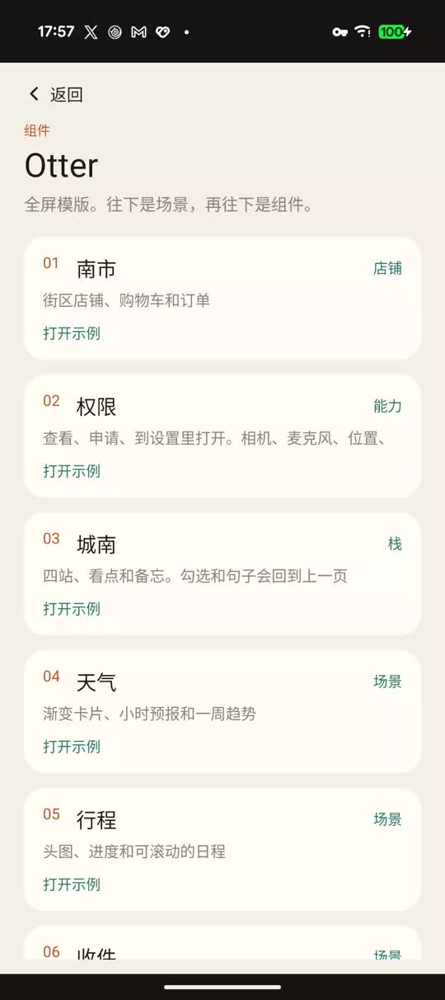

# Otter

Android SDK。仓库首页在 [README.md](../README.md)：五个端、Demo 录像，以及可以点开的示例 JSON。产品介绍、节点、事件和示例目录以那一页为准。这一页写 Android 怎么编译、接入和画页面。

Otter 给大模型做生成式 UI。模型或服务只产出一份受约束的 JSON 模版，这一端用原生 `View` 画出来。

页面结构和数据分开。结构是 JSON 模版，数据是另一份 JSON。布局使用来自 [GaiaX](https://github.com/alibaba/GaiaX) 的 Flexbox 引擎，`$` 表达式使用来自 GaiaX 的表达式引擎。出处、许可证和本仓库中的对应文件见文末[来源声明](#来源声明)。

当前仓库先把渲染协议和原生渲染器做稳。Demo 里的模版放在 assets 中，用来验证组件、事件和解析器。后面接上大模型时，变的是模版从哪来，渲染链路不变。生成时要遵守的输出约定写在 [docs/template-format.md](docs/template-format.md)：只输出一份 JSON，结构归模版，数据归另一份 JSON。

## 文档

| 文档 | 内容 |
| --- | --- |
| [docs/render-pipeline.md](docs/render-pipeline.md) | 模版怎么被解析、布局、画出来，事件和页面栈怎么走 |
| [docs/sdk-integration.md](docs/sdk-integration.md) | 业务工程怎么接入：画一页、刷新、多页、服务端模版包、权限 |
| [docs/template-format.md](docs/template-format.md) | 写或生成模版时要遵守的 JSON 格式 |
| [docs/node-types.md](docs/node-types.md) | 十二种节点各自能写哪些字段 |
| [docs/demo-guide.md](docs/demo-guide.md) | Demo 有哪些页面，以及真机怎么调试生成页 |

仓库级的架构和协议索引在 [docs/README.md](../docs/README.md)。Web 端的同一套协议在 [otter-web](../otter-web/README.md)。

## 介绍

<table>
<tr>
<td align="center" width="50%">
<a href="docs/media/intro.mp4"></a>
</td>
<td align="center" width="50%">
<a href="docs/media/generate.mp4"></a>
</td>
</tr>
<tr>
<td align="center"><a href="docs/media/intro.mp4">走查</a> · 16 秒<br>首页、天气卡、城南，再点进「旧巷咖啡」。<a href="docs/demo-guide.md">说明</a></td>
<td align="center"><a href="docs/media/generate.mp4">生成</a> · 20 秒<br>查询「买蛋炒饭的食材」，点进「隔夜米饭」。<a href="docs/demo-guide.md#查询下发">查询下发</a></td>
</tr>
</table>

## 协议说明

产品介绍、和其它方案的对照、节点表、事件表，以及可以点开的示例 JSON，写在仓库首页 [README.md](../README.md)。字段以 [docs/template-format.md](docs/template-format.md) 和 [docs/node-types.md](docs/node-types.md) 为准。

下面从 Android 的模块和编译开始。

## 模块

| 模块 | 类型 | 说明 |
| --- | --- | --- |
| `:OTAndroid` | Android Library | 模版解析、布局、视图创建、事件分发。包名 `com.dynamic.otter`，namespace `com.dynamic.outter` |
| `:Demo` | Application | 示例应用。首页和各组件页都是 assets 里的模版 |

模版示例在 `Demo/src/main/assets/templates/`。字段写法见 [docs/template-format.md](docs/template-format.md)。节点和事件以 `OTAndroid` 里的 `TemplateJsonParser` 为准。

## 环境

- JDK 17
- Android SDK，`compileSdk` 36，`minSdk` 26。Demo 的 `targetSdk` 也是 36。三个数写在 `gradle/libs.versions.toml`
- Android Gradle Plugin 8.5.1 官方测到 `compileSdk` 34。现在用 36 编译可以通过，Gradle 会提示建议换更新的插件
- Android Gradle Plugin 8.5.1，Kotlin 1.9.0
- Gradle 8.7，仓库自带 Wrapper
- NDK `30.0.16248370`，CMake 3.10.2。版本写在 `OTAndroid/build.gradle.kts` 里，用来编 `OTAnalyze`，并让 `libc++_shared.so` 按 16 KB 页对齐
- 真机或模拟器使用 **arm64-v8a**。预编译的 `libstretch.so` 只放了这个 ABI：`OTAndroid/src/main/jniLibs/arm64-v8a/`

## 编译和运行

用 Android Studio 打开仓库，运行 `:Demo`。命令行：

```shell
./gradlew :Demo:assembleDebug
./gradlew :OTAndroid:testDebugUnitTest
```

Demo 的 `applicationId` 是 `com.senseauto.sensedyne.demo`。启动后是导航页，点列表项会打开对应示例。

## 接入

业务模块依赖库：

```kotlin
implementation(project(":OTAndroid"))
```

把模版和数据放进 assets，在容器拿到宽高之后渲染。容器尺寸变化时调用 `relayout`，不要重新解析模版。

```kotlin
val template = OTEngine.instance
    .init(activity)
    .buildTemplate("demo", "screen", "templates/text/text.json")
template.setData(AssetsUtils.parseAssetsToString(activity, "templates/text/mock-data/text.json"))

val view = OTEngine.instance.createAndroidView(
    template,
    OTEngine.OTViewPortSize(container.width.toFloat(), container.height.toFloat())
)
container.addView(view)

OTEngine.instance.relayout(
    template,
    OTEngine.OTViewPortSize(container.width.toFloat(), container.height.toFloat())
)
```

`buildTemplate` 的前两个参数是业务 id 和模版 id，目前只记在 `OTTemplate` 上。真正读文件的是第三个参数，assets 相对路径。页面不再使用时调用 `TemplateContext.release()`。

Demo 里这套流程封装在 `Demo/src/main/java/com/dynamic/otter/demo/TemplateScreen.kt`，并处理了 edge-to-edge 和键盘 inset。

模版里的 `open` 自己不渲染下一页。当前 Activity 挂了 `PageStack` 时，打开和返回走页面栈，见下文。没挂栈时，宿主注册一个打开回调，参数只有页面名：

```kotlin
ExpansionCenter.instance.registerPageOpener { context, page ->
    // 按 page 打开对应页面
}
```

没注册，或 `page` 为空时，点击会 toast「这个页面还打不开」。没挂栈时，`back` 结束当前 `Activity`。

## 权限

模版不写系统权限名。宿主在当前 `Activity` 上调用 `AndroidPermissionCenter.install` 之后，模版可以用三个 host：

| name | 作用 |
| --- | --- |
| `permissionCheck` | 只查询，不弹窗 |
| `permissionRequest` | 先显示宿主写死的说明，再走系统申请。相册打开系统选图 |
| `permissionOpenSettings` | 打开应用设置，返回后重新查询 |

`params.capability` 只能是 `camera`、`microphone`、`location.whenInUse`、`photos`、`notifications`。没在安装包里声明的权限，状态是「当前版本没有这项」。

结果写进当前页：`cameraStatus`、`cameraStatusText`、`cameraShowSettings`。麦克风、定位、相册、通知用同样的前缀。定位给了精确位置时文案是「已允许，精确位置」，只给大致位置时是「只给了大致位置」。`cameraShowSettings` 为 true 表示系统不会再弹框。相册选中一张后额外写 `photoSrc` 和 `avatar`，图片地址可以是 `content:`。

相册不申请读取整个相册。通知在 Android 13 以下视为已允许。说明文案用 `PermissionPrompts` 或宿主自己的表，不要从模版里取。

这一版实现的是 Android。能力名、三种动作和写回的字段是 iOS、HarmonyOS 可以沿用的同一份约定。

南市在 `MarketActivity` 里装了自己的说明：首页问定位，店铺问相机和麦克风，支付成功页问通知，我的可以换头像，并在打开时刷新五项状态。首页「权限」把五项各放成一张卡片，每张都有查看、申请和去设置。

## 一次渲染做了什么

1. `TemplateJsonParser` 把 JSON 收成节点树和事件表。未知字段、未知 `type`、悬空的 `onClick` 或 `target` 会直接抛 `TemplateParseException`。
2. `VDomNode` 把节点和 `TemplateContext` 绑在一起。
3. `NodeTreePrepare` 生成 `OTNode`，交给 Stretch 按视口算出每个节点的位置和大小。
4. `OTViewTreeCreator` 按节点类型创建 Android `View`，绑定文案、图片、列表和点击。
5. 点击按事件的 `class` 分到对应 worker：`view` 改属性，`util` 做 toast，`nav` 做打开和返回，`list` 做追加。

`relayout` 只按新的视口重算 Stretch，并把结果写回已有 `View` 的 `layoutParams`。

## 页面栈

一个 Activity 里要打开多份模版时，用 `PageStack`。渲染还是原来的 `buildTemplate`、`setData`、`createAndroidView`、`relayout`、`release`。栈只决定哪一页放在容器里。

壳在 `setContentView` 之后挂上栈。`insetRoot` 接收系统栏和键盘的 padding，`container` 用来放当前页：

```kotlin
val stack = PageStack.attach(
    this,
    findViewById(R.id.main),
    findViewById(R.id.stack_container),
    "templates/stack/routes.json",
    "demo",
    "stack"
)
```

`onDestroy` 里调用 `stack.release()`。路由是一份 assets JSON，只认 `start` 和 `pages`。每一页有 `template`，可以再给一份 `data`：

```json
{
  "start": "shelf",
  "pages": {
    "shelf": {
      "template": "templates/stack/shelf.json",
      "data": "templates/stack/mock-data/shelf.json"
    },
    "place_coffee": {
      "template": "templates/stack/place.json",
      "data": "templates/stack/mock-data/coffee.json"
    },
    "stop": { "template": "templates/stack/stop.json" },
    "memo": {
      "template": "templates/stack/memo.json",
      "data": "templates/stack/mock-data/memo.json"
    }
  }
}
```

同一份模版可以挂到多个页面名上，各自带不同的数据。城南的四站就是这样。路由表就是这个 App 的页面登记，模版只能打开表里有的页面名。

打开和返回由模版里的 `open`、`back` 触发，`NavEventWorker` 用 `PageStack.find` 判断当前 Activity 有没有挂栈。

- 有栈时，`open` 用页面名查路由。先读这一页的 data 文件，再用事件里的 `params` 盖上去。`params` 可以嵌套对象和数组。`$` 表达式按「页面数据 + 列表项」求值，列表项里的同名字段优先。带 `id` 的输入框和勾选会先写进当前页的数据，所以 `$draft`、`$been` 能读到界面上的值。栈顶已经是这个页面名，并且这些参数和当前数据一致时，不再压一页。然后 `createAndroidView`。上一页的 View 在滑走之后 `release`，页面 JSON 留在栈上。
- `back` 在栈深大于 1 时摘掉栈顶。系统返回键由 `PageStack` 接到 `pop()`：栈里还有上一页就弹出，已经是首页时把事件交还 Activity。若栈顶只有一个带 `params` 的 `back`，系统返回也会带上那份参数。从列表项打开的页面，结果写回那一项；否则合并进上一页顶层。上一页再用这份数据重新画出。只剩一页时 `pop()` 返回 false。
- `ComponentActivity` 上，旋转和进程重建会按路由、业务 id、模版 id 恢复整栈的页面 JSON。对不上、JSON 坏了，或序列化超过约 20 万字符时，从 `start` 重新打开。
- 没挂栈时，行为与原来一样：`open` 把页面名交给 `ExpansionCenter.pageOpener`，不传 `params`；`back` 直接 `finish()`。Demo 里除城南以外的示例仍走这条路径。

新页面从结束边滑入，返回时向结束边滑出。容器还没有宽高，或系统关掉了动画时，直接切换。

城南这条路线是：`shelf` 列出四站，每站打开自己的 `place_*`。地点页里的看点用页面上的颜色和标题，加上这一项的名称、时间，打开共用的 `stop`。看点页的勾选写回对应的那一项，再打开时还在。右上角「记一句」打开 `memo`，返回时把 `$lines` 放进地点页的 `memos`。

## 页面栈现在的缺点

一个 Activity 里可以用模版把页面串起来。它还不是一整个 Android 应用。

- 页面名必须先写在路由表里。模版不能打开一张路由里没有的新页面，也不能在事件里直接写模版路径。路由 JSON 不合法时 `attach` 直接抛异常。页面打不开时只有一句 toast「这个页面还打不开」。
- 恢复下来的是页面 JSON、带 `id` 的表单值和列表的滚动位置。列表项里面的输入和勾选不会写回那一项。`column` 写了 `scroll: true` 时，子节点在列内滚动，这个滚动位置不记。焦点、输入法、`setText` 改过的普通文本、进度和 Lottie 帧都不记。
- 状态放不进 Bundle 时，旋转或进程重启后从 `start` 重开。不是 `ComponentActivity` 的壳拿不到系统返回键和恢复。
- 重复打开只比较栈顶。下面已经有同名页面时，仍会再压一层。模版可以写 `popTo` 指定要回到的页面名。业务 id 和模版 id 在 `attach` 时定死。
- 节点仍然只有 `column`、`row`、`text`、`image`、`spacer`、`list`、`progress`、`lottie`、`input`、`checkbox`、`radio`、`switch`。没有地图、支付、网页、音视频，也不能从模版再启动一个 Activity。权限不是节点，走 host。

## Demo 页面

首页列出下面这些入口，路由在 `DemoRoutes`。每份模版和数据可以在仓库首页的 [Demo 示例](../README.md#demo-示例) 点开。

| page | 模版 |
| --- | --- |
| `permission` | `templates/permission/routes.json`。相机、麦克风、位置、相册、通知，每项可以查看、申请、去设置 |
| `market` | 南市。底栏三个原生 Tab 各有自己的栈：首页 `templates/market/routes.json`（店铺、购物车、支付，首页问定位，店铺问相机和麦克风，支付成功问通知），订单 `routes-orders.json`，我的 `routes-mine.json`（换头像，并查看五项状态） |
| `stack` | `templates/stack/routes.json`。四站共用地点模版，看点的勾选写回那一项，备忘的句子回到地点页 |
| `weather` | `templates/weather-card-demo/weather-card.json` |
| `column` `row` `text` `image` `spacer` | 对应基础组件 |
| `list` `progress` `lottie` `input` `checkbox` `radio` `switch` | 对应组件 |
| `inbox` `journey` `player` `chat` `glass` | 组合场景 |

播放器页会在模版渲染完成后额外挂上 `PlayerSession`，用来驱动播放状态。

## 来源声明

Otter 的 Flexbox 布局引擎和表达式引擎来自阿里巴巴优酷技术团队的开源项目 [GaiaX](https://github.com/alibaba/GaiaX)。GaiaX 版权归 Alibaba Group Holding Limited（Copyright (c) 2021），以 [Apache License 2.0](https://github.com/alibaba/GaiaX/blob/main/LICENSE) 发布。原始归属同时写在本仓库的 [NOTICE](NOTICE) 里。

这两部分在本仓库中做了接入。Flexbox 仍使用上游的库名和包名。表达式引擎由 `GX*` 重命名为 `OT*` 后编进 `:OTAndroid`。模版协议、组件和页面渲染流程是 Otter 自己的。

| 能力 | 上游 | 许可证 | 在本仓库中的位置 |
| --- | --- | --- | --- |
| Flexbox 布局引擎 | [GaiaXStretch](https://github.com/alibaba/GaiaX/tree/main/GaiaXStretch)。它是 GaiaX 维护的 Stretch，Kotlin 绑定在 [bindings/kotlin](https://github.com/alibaba/GaiaX/tree/main/GaiaXStretch/bindings/kotlin)。Stretch 原作为 Visly Inc.，Copyright (c) 2018，许可证为 [MIT](https://github.com/alibaba/GaiaX/blob/main/GaiaXStretch/LICENSE)。GaiaX 的 [NOTICE](https://github.com/alibaba/GaiaX/blob/main/NOTICE) 有同样说明 | Stretch 本体为 MIT | `OTAndroid/src/main/jniLibs/arm64-v8a/libstretch.so`，`OTAndroid/src/main/kotlin/app/visly/stretch/` |
| 表达式引擎 | [GaiaXAnalyze](https://github.com/alibaba/GaiaX/tree/main/GaiaXAnalyze)。核心实现是 [GXAnalyzeCore](https://github.com/alibaba/GaiaX/tree/main/GaiaXAnalyze/GXAnalyzeCore)（`GXAnalyze`、`GXWordAnalyze`、`GXATSNode`、`GXValue`）。Android JNI 是 [GXAnalyzeAndroid](https://github.com/alibaba/GaiaX/tree/main/GaiaXAnalyze/GXAnalyzeAndroid) 的 `GXJniAnalyze.cpp` 和 `com.alibaba.gaiax.analyze` | Apache License 2.0 | `OTAndroid/src/main/cpp/` 下的 `OTAnalyze`、`OTWordAnalyze`、`OTATSNode`、`OTValue`、`OTJniAnalyze`，以及 `com.dynamic.otter.expression.analyze` |

引用：

- 项目主页：[https://github.com/alibaba/GaiaX](https://github.com/alibaba/GaiaX)
- 文档：[https://youku-gaiax.github.io/](https://youku-gaiax.github.io/)
- 许可证：[https://github.com/alibaba/GaiaX/blob/main/LICENSE](https://github.com/alibaba/GaiaX/blob/main/LICENSE)
- 第三方组件声明：[https://github.com/alibaba/GaiaX/blob/main/NOTICE](https://github.com/alibaba/GaiaX/blob/main/NOTICE)
- Flexbox：[https://github.com/alibaba/GaiaX/tree/main/GaiaXStretch](https://github.com/alibaba/GaiaX/tree/main/GaiaXStretch)
- 表达式引擎：[https://github.com/alibaba/GaiaX/tree/main/GaiaXAnalyze](https://github.com/alibaba/GaiaX/tree/main/GaiaXAnalyze)
