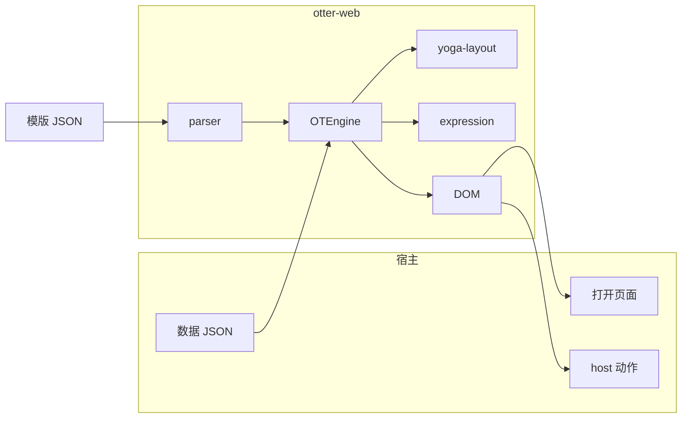

# 渲染链路

Web SDK 读一份 JSON 模版，校验之后画成 DOM。Demo 用 `otter-web/templates` 里的模版把这条链路跑通。

字段以 [template-format.md](../../otter-android/docs/template-format.md) 为准。这里写这些字段进浏览器之后落在哪。

## 边界



模型、提示词和网络请求不在这个包里。点击只能走到事件表里登记过的动作。

## 代码放在哪

```
src/
├── parser.ts        模版校验，错误文案和 Android 一致
├── expression.ts    $ 表达式
├── layout.ts        Yoga 布局
├── measure.ts       文字测量
├── view.ts          DOM、列表、输入和点击
├── events.ts        事件
├── page-stack.ts    页面栈和浏览器历史
├── permission.ts    五项能力
├── bundle.ts        签名包
├── engine.ts        OTEngine
└── sdk.css          节点、滚动、玻璃和 toast
```

`demo/` 是示例壳，不是 SDK。播放和南市的业务动作放在那里。

## 解析

`parseTemplate` 接受模版字符串。未知字段、未知 `type`、悬空的 `onClick`、`onChange` 或 `target` 抛 `TemplateParseException`。节点上限 2000，深度上限 32。

尺寸在内部记成 `match_parent` 和 `wrap_content`。颜色 `#AARRGGBB` 转成 CSS 的 `#RRGGBBAA`。`style.glass` 只允许出现在 column、row、spacer 上，并且不能和 `background` 同时写。

路由用 `parseRoutes`。合法字段只有 `start` 和 `pages`，页面里是 `template` 和可选的 `data`。

## 表达式

语法和 GaiaX / `OTAnalyze` 相同：`$path`、`$$`、单引号字符串、数字、`true` / `false` / `null`、三元、`?:`、`||`、`&&`、比较、`+ - * / %`、一元 `! + -`，以及 `size()` 和 `env()`。

`getResult` 在解析失败或求值结果为 null 时返回 null。显示时 null 退回原来的字符串。列表项展示只用该项；事件把页面数据放在下面、列表项盖在上面。

`&&` 两边都为真时取右边的值，否则是 false。`||` 取第一个为真的值。null、false、空字符串和 0 算假。

不认识的函数或 `env` 名字会失败，显示原文。`env('isWeb')` 为真，`env('isAndroid')` 和 `env('isiOS')` 为假。

## 布局

布局用 `yoga-layout`。不调用 `useWebDefaults()`，这样默认 `flexShrink` 仍是 0，和 Stretch 一致，纵向滚动的内容才能高出视口。数字尺寸先按设计宽 375 换算：窗口宽不超过 480，缩放不低于 0.88，和 Android、iOS 的 `ScreenAdapt` 相同。传入 `density` 时用给定值，不再换算。

视口是一个固定宽高的列，模版根节点是它唯一的子节点，所以 `fill` 能按百分比算。文字和宽高为 `wrap` 的叶子使用测量函数。测量先取文字本身的宽度，超出可用宽度再折行，因此 `width: "wrap"` 的标签不会被拉成整行。

列表不是 Yoga 的子树。列表盒子先占好视口，每一项再用 `layoutItem` 单独排。聊天行的 `justify` 求出 `"end"` 时，按 Android 的做法镜像子节点：水平位置改成 `父宽 - x - 宽`，头像和气泡换到右边。

可滚动的列用一层内层容器撑出内容高度，绝对定位的子节点本身不增加滚动高度。容器的内边距由 Yoga 算进子节点坐标，CSS padding 只加在文字、输入和勾选这些叶子上。

## 绘制

每个节点是绝对定位的 `.otter-node`。页面级 `id` 不含列表项内部的节点。点击从目标往上找 `data-otter-click`，输入框上的点击不冒泡成节点点击。

`setText` 和 `setImage` 记在节点上，后续 `relayout` 不会把它们盖掉。`rebind` 会按数据重画，并清掉这些覆盖。

Lottie 用 `lottie-web`。`repeat` 为 `infinite` 或次数，`mode` 为 `reverse` 时先正向再反向，每个循环换一次方向。`assets:` 相对 Demo 的 assets 目录，`res:` 由 `OTEngine` 换成实际地址。

列上的 `res:` 背景比节点高、且节点本身不滚动时，拖动可以平移背景。这和滚动冲突，模版里不要两样一起开。

玻璃画在节点背后的位图上，子节点仍盖在上面。参数和 Android 的 `LiquidGlassDrawable` 相同，也就是 iOS `UIGlassEffect` 的 regular / clear：`regular` 折射 12、斜面 16、中心薄霜 6，缺省染色 `#2EFFFFFF`；`clear` 折射 18、斜面 24、没有中心霜，缺省染色 `#0AFFFFFF`。圆角边缘按距离把背后的画面沿法线拉开，并带一点色散；靠近上沿加一道亮边，下沿略压暗。按下时折射和染色各乘 1.28。采样的是祖先节点上的 `res:` 背景，所以拖动壁纸时玻璃里的画面跟着动。背后没有位图时，才退回一层薄染色。

## 事件和栈

`toast`、`setText`、`setTextStyle`、`setChecked`、`append`、`update`、`remove`、`open`、`replace`、`popTo`、`back`、`host` 都在 `events.ts`。

`open` 和 `back` 求参数之前，先对带 `id` 的控件做一次快照，跳过列表项内部。输入框的快照读的是已经写进 `data[id]` 的文字。`back` 若带着结果，写回打开这一页时的那条列表项；对不上时合并到上一页。

第一页不 `pushState`。之后每次 `open` 推入一条 `{ otter: token }`。顶栏返回调用 `history.back()`，并用标记避免 `popstate` 再弹一次。`replace` 不增加历史条目。浏览器返回弹出的是当初 `pushState` 的那一套栈。南市有三套栈时，若先在一个底栏里打开子页再换底栏，浏览器返回仍作用在推入历史的那一套上。顶栏返回看的是当前可见的栈。

## 权限和包

权限查询用 Permissions API。申请分别走 `getUserMedia`、定位、`Notification` 和文件选择。相机和麦克风在确认授权后停掉轨道，这次只记录允不允许。相册把选中的文件做成 `blob:` 地址。

签名包的读取、摘要和验签在 `bundle.ts`。摘要在文本按 UTF-8 重新编码后计算，合法 JSON 与原始字节一致。校验通过才解析路由和模版。
